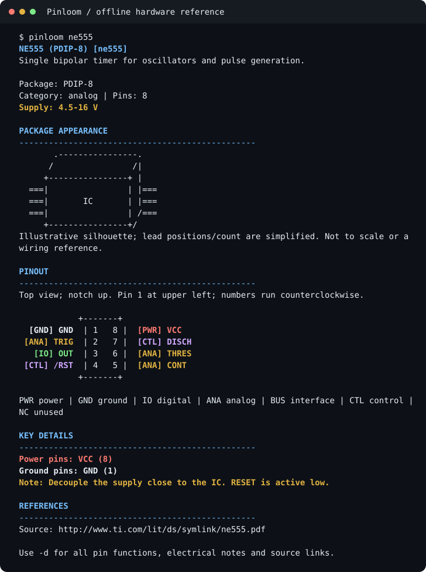

# Pinloom

Look up chip, board, and connector pinouts directly from your terminal(pretty awesome right :)). Pinloom includes
**2,088 components and 39,934 pins**, plus package sketches, electrical notes,
and pin functions where available. After installation, lookups work offline.

Requires **Python 3.10+** and runs on Windows 10/11, Linux, and macOS.



```text
NE555 (PDIP-8) [ne555]
Supply: 4.5-16 V

PACKAGE APPEARANCE
       .----------------.
      /                /|
     +----------------+ |
  ===|                | |===
  ===|       IC       | |===
  ===|                | /===
     +----------------+/
Illustrative silhouette; not a footprint or wiring reference.

PINOUT
            +-------+
  [GND] GND | 1   8 | [PWR] VCC
 [ANA] TRIG | 2   7 | [CTL] DISCH
   [IO] OUT | 3   6 | [ANA] THRES
 [CTL] /RST | 4   5 | [ANA] CONT
            +-------+

KEY DETAILS
Power pins: VCC (8)
Ground pins: GND (1)
Note: Decouple the supply close to the IC. RESET is active low.
```

## Installation

Before you start, make sure you have **Python 3.10 or newer**, Git, and an internet
connection. You'll only need the connection for installation and database updates.
If Python isn't installed yet, download it from [python.org](https://www.python.org/downloads/).
On Debian/Ubuntu, run `sudo apt install python3-venv` if setup reports
missing `venv` or `ensurepip`.

Start by cloning the repository:

```sh
git clone https://github.com/norbertsawe/pinloom.git
cd pinloom
```

Follow the steps for your terminal below. On Windows, use PowerShell or Command
Prompt. If you're using WSL, follow the Linux steps inside WSL.

Setup installs Pinloom in a dedicated Python environment and **adds the command to PATH
automatically**. You won't need administrator access or have to activate an environment
to run Pinloom. The extra PATH line in each block lets you start using
Pinloom in your current terminal too, without reopening it.

### Linux and macOS — bash or zsh

```sh
bash setup.sh
export PATH="$HOME/.local/bin:$PATH"
pinloom --version
pinloom ne555
```

Setup handles PATH for bash, zsh, POSIX login shells, and fish, including custom
`ZDOTDIR` and `XDG_CONFIG_HOME` locations. You can rerun setup; it updates
its own marked block while preserving your other settings.

To use a specific Python version, pass it to setup:
`PYTHON=python3.12 bash setup.sh`.

### Linux and macOS — fish

```fish
bash setup.sh
fish_add_path "$HOME/.local/bin"
pinloom --version
pinloom ne555
```

### Windows — PowerShell

```powershell
powershell.exe -NoProfile -ExecutionPolicy Bypass -File .\setup.ps1
$env:Path = "$env:LOCALAPPDATA\Pinloom\bin;$env:Path"
pinloom --version
pinloom ne555
```

The execution-policy bypass only applies to this setup process. Your saved
policy remains unchanged. Setup adds Pinloom to your **user PATH**, preserves
existing entries, and doesn't modify the machine PATH or use `setx`.

If you need a specific Python installation, add
`-PythonExe 'C:\Python312\python.exe'` to the setup command.

### Windows — Command Prompt (cmd.exe)

```bat
setup.cmd
pinloom --version
pinloom ne555
```

`setup.cmd` also refreshes PATH in the current window, so Pinloom is available
immediately. If you're running setup from another batch file, use `call setup.cmd`
so the calling script continues afterward.

### Installation locations

| System | Private Python environment | Command directory added to PATH |
| --- | --- | --- |
| Linux | `~/.local/share/pinloom/venv` | `~/.local/bin` |
| macOS | `~/Library/Application Support/pinloom/venv` | `~/.local/bin` |
| Windows | `%LOCALAPPDATA%\Pinloom\venv` | `%LOCALAPPDATA%\Pinloom\bin` |

On Linux, setup uses `XDG_DATA_HOME` if you've set it. You can move or delete
the cloned repository after installation; Pinloom will keep working. Keep its
private Python environment in its original location.

To update Pinloom, pull the latest changes and run setup again.

### If the command is still not found

Check that setup finished without errors, then try a new terminal. On Windows,
you might need to close and reopen Windows Terminal or VS Code completely;
a new tab can still pick up the old PATH.

You can also refresh PATH in your current terminal:

| Terminal | Make Pinloom available now | Check the resolved command |
| --- | --- | --- |
| bash / zsh | `export PATH="$HOME/.local/bin:$PATH"` | `command -v pinloom` |
| fish | `fish_add_path "$HOME/.local/bin"` | `type -p pinloom` |
| PowerShell | `$env:Path = "$env:LOCALAPPDATA\Pinloom\bin;$env:Path"` | `Get-Command pinloom` |
| Command Prompt | `set "PATH=%LOCALAPPDATA%\Pinloom\bin;%PATH%"` | `where pinloom` |

If PATH still needs updating, these commands repair it for future terminals.
They won't download or reinstall anything:

```sh
# Linux / macOS, from the checkout
python3 tools/install.py --path-only
```

```powershell
# Windows, from the checkout
py -3 tools\install.py --path-only
```

If you'd rather manage PATH yourself, use `bash setup.sh --no-path` or
`.\setup.ps1 -NoPath`. Run `python3 tools/install.py --help`
(`py -3 tools\install.py --help` on Windows) for options such as choosing a different
install location or omitting optional YAML support.

If you already use [pipx](https://pipx.pypa.io/), you can use that instead.
From the repository, run `pipx install ".[yaml]"`, then `pipx ensurepath`, and open
a new terminal. Choose one installation method; running both is unnecessary.

## Usage

```sh
pinloom pico                        # Show a pinout
pinloom "Arduino Uno" -d             # Include electrical notes and pin functions
pinloom --search esp32               # List matching components
pinloom -i esp32                     # Choose a component interactively
pinloom 555                         # Look up an alias
pinloom pico --pin SPI -d            # Filter by pin function
pinloom atmega328p --pin 17 -d       # Inspect a physical pin
pinloom --categories                # See categories and component counts
pinloom --list --category sensors --limit 20
pinloom --search mcp --limit 10
pinloom --list --offset 20 --limit 20 # Browse the next page
pinloom --list                      # List the catalog
pinloom --update                    # Update the cached database
pinloom --help                      # Show all options
```

You don't have to get the name exactly right. Names and aliases ignore case
and punctuation, and partial names or typos open a finder in your terminal.
Select a result, refine your search, or press `q` to exit.

When you're piping output or running a script, Pinloom gives you suggestions
instead of stopping for input. You can also use `--no-interactive` to turn
prompts off explicitly.

For supported IC, transistor, board, and connector packages, a package sketch
appears above the pinout to help identify its general shape. Use the pin grid
and datasheet for wiring. The sketches simplify
lead positions and counts. If the package isn't recognized or your terminal
is too narrow, Pinloom omits the sketch. Use `--no-art` to hide it manually.

Headings, supply information, and pin types have their own contrast and colors
to make key information easier to scan. Below the grid, you'll find power
and ground connections, electrical details, and any connection restrictions
recorded in the catalog. Add `-d` for every pin's functions and notes.
For imported components, check the datasheet for electrical limits.

The labels cover power, ground, I/O, analog, interface, control, and unused pins.
On a narrow terminal, the grid becomes a vertical list so you can still read
all the pin names.

Use `--ascii` for simple borders, `--width 40` to set the output width, or
`--no-color` for plain text. Pinloom also respects `NO_COLOR`, and piped output
is plain by default. If you resize your terminal, run the command again to fit
the new width.

## Exports and custom pinouts

```sh
pinloom pico --export pico.json
pinloom ne555 --export timer.yaml
pinloom uno --export uno.csv
pinloom esp32s3 -d --export esp32.md
pinloom pico --format json
pinloom --validate examples/custom.json
pinloom --custom examples/custom.yaml my-sensor -d
```

You can export to **text, JSON, YAML, CSV, or Markdown**. Pinloom selects the format
from the file extension, or you can choose one with `--format`. Use `--pin` if
you only need certain pins in the export.

You can also load JSON and YAML exports as custom components.

To load your own pinouts automatically, place their JSON or YAML files in the
`components` folder inside your config directory. Run `pinloom --about` to see where it looks, or choose your own
locations with `--config-dir` and `--data-dir`.

| Platform | Config | Cache |
| --- | --- | --- |
| Windows | `%APPDATA%\pinloom` | `%LOCALAPPDATA%\pinloom` |
| Linux | `~/.config/pinloom` | `~/.local/share/pinloom` |
| macOS | `~/Library/Application Support/pinloom` | Config directory's `data` subdirectory |

On Linux, you can also set `XDG_CONFIG_HOME` and `XDG_DATA_HOME`. The
`PINLOOM_CONFIG_DIR` and `PINLOOM_DATA_DIR` overrides work on every supported OS.
The [database guide](docs/database.md) has the file format, examples, and details
on which definitions take priority and how updates work.

## Component database

The original 88 entries come from
[pinout-pages](https://github.com/norbertsawe/pinout-pages). The catalog also
includes 2,000 package-specific entries adapted from a fixed 2020 snapshot
of KiCad's symbol library. The full **2,088-component catalog** is available offline
from the first run.

`--update` refreshes the downloaded database cache and leaves your custom
pinouts unchanged.

You'll find Arduino Uno/Nano, ATmega328P, ESP32/S3/C3, ESP8266, Blue Pill,
NUCLEO-F401RE, Pico/RP2040, 555 timers, 74HC logic, LM358/NE5532 amplifiers,
MCP23017, PCM5102A, ADCs/DACs, USB connectors, Raspberry Pi GPIO, and SWD/JTAG/ICSP,
among others.

The [original catalog](https://github.com/norbertsawe/pinout-pages/blob/main/CATALOG.md)
lists the first set of packages and their sources. For everything in your
installed version, use `pinloom --categories` or `pinloom --list --format json`.

Listings show a description, category, pin count, and package for each component.
In a terminal, you'll get 20 results at a time. Pipes and JSON give you the full
list unless you set `--limit`. Combine `--category`, `--search`, `--limit`, and
`--offset` to refine the results. In the interactive finder, `n` and `p` take
you to the next and previous pages.

The imported entries keep KiCad's pin labels and electrical types. Their tables
use physical pad numbers; they aren't footprint drawings. The imports haven't
each been independently checked against manufacturer datasheets. You'll still
need the datasheet for supply limits and the full list of alternate functions.

Use `pinloom COMPONENT -d` to see the source links and import notes. The
[catalog provenance notes](docs/catalog-provenance.md) explain where the data
comes from, how to reproduce the import, and how it's licensed.

Check the package or board revision before connecting hardware. A different
package or clone board can have a different pinout. The linked datasheet or
schematic is the place to confirm orientation, electrical limits, and footprint
dimensions.

## Development

If you'd like to contribute to Pinloom, [CONTRIBUTING.md](CONTRIBUTING.md) covers
setup, tests, packaging, and database updates. CI checks Windows, Linux, and
macOS with Python 3.10, 3.12, and 3.14.

## Upgrading from pinout-cli

If you used pinout-cli before, the package, Python module, and command are now
called `pinloom`. Follow the setup steps above, then update any aliases or
scripts that still call `pinout`.

Once Pinloom is installed, you can remove this project's old `pinout-cli`
package with `python -m pip uninstall pinout-cli`. Use the Python interpreter
from that old installation's environment. Pinloom doesn't install the old
`pinout` command.

New config and cache folders use the `pinloom` name. If you still have the old
`pinout` folders, Pinloom can read them until the new ones exist. The old
`PINOUT_CONFIG_DIR` and `PINOUT_DATA_DIR` variables still work for migration,
but `PINLOOM_CONFIG_DIR` and `PINLOOM_DATA_DIR` take priority when both are set.

Your files won't be moved or deleted automatically. Run `pinloom --about` to
check the active paths. The separate `pinout-pages` database still
lives at its existing URL.
